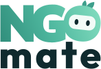

<div align="center">

<picture>
  <source media="(prefers-color-scheme: dark)" srcset="apps/site/public/logo-dark.svg" />
  
</picture>

**A free, open-source AI assistant for NGO back-office work, on your own computer.**

[](https://github.com/welt-weit/ngomate/actions/workflows/check.yml)
[](LICENSE)
[](https://ngomate.org)


[Download](#download) · [Website](https://ngomate.org) · [Report an issue](https://github.com/welt-weit/ngomate/issues) · [Getting started](#getting-started)

</div>

## About

NGOmate helps the people who run small NGOs with the writing and searching that eat their week. You give it your notes, a funder's question or a report you wrote last year, and it drafts the proposal section, the supporter update or the report for you to check and finish. Connected to a search service, it looks for open funding calls that fit your organization.

It does this with an AI model that runs on your own laptop. There is no subscription, no account, and your documents do not go to anyone's servers unless you connect something yourself.

> [!NOTE]
> NGOmate is an early preview, and things will change.

## Download

| System | Installer |
|---|---|
| Mac with Apple silicon (M1 or later) | [NGOmate-mac-apple-silicon.dmg](https://github.com/welt-weit/ngomate/releases/latest/download/NGOmate-mac-apple-silicon.dmg) |
| Mac with Intel | [NGOmate-mac-intel.dmg](https://github.com/welt-weit/ngomate/releases/latest/download/NGOmate-mac-intel.dmg) |
| Windows | [NGOmate-windows-setup.exe](https://github.com/welt-weit/ngomate/releases/latest/download/NGOmate-windows-setup.exe) |
| Linux | [AppImage](https://github.com/welt-weit/ngomate/releases/latest/download/NGOmate-linux.AppImage) · [.deb](https://github.com/welt-weit/ngomate/releases/latest/download/NGOmate-linux.deb) · [.rpm](https://github.com/welt-weit/ngomate/releases/latest/download/NGOmate-linux.rpm) |

These always point to the latest release. Every version, with the files named by version, is on the [releases page](https://github.com/welt-weit/ngomate/releases). The model is a separate download, chosen inside the app.

> [!IMPORTANT]
> The installers are not signed yet, so your system warns you the first time you open NGOmate. On a Mac, open it once, then choose **Open Anyway** under System Settings → Privacy & Security. On Windows, choose **More info** → **Run anyway** in the SmartScreen message.

## Table of contents

- [About](#about)
- [Download](#download)
- [What you can do with it](#what-you-can-do-with-it)
- [Features](#features)
- [Working as a team](#working-as-a-team)
- [Knowledge base](#knowledge-base)
- [What leaves your computer](#what-leaves-your-computer)
- [Requirements](#requirements)
- [Getting started](#getting-started)
- [Project structure](#project-structure)
- [Development](#development)
- [Built with](#built-with)
- [Contributing](#contributing)
- [License](#license)

## What you can do with it

| Task | You give it | You get |
|---|---|---|
| **Draft a proposal section** | The funder's question and its word limit, plus your notes or a document | A first draft of that section, within the limit and using only your facts, plus a list of what the funder asks for that your material doesn't cover |
| **Write an update or report** | Who it is for and how long, plus your notes or a document | A supporter update, article or report section |
| **Find funding opportunities** | Who you are, what you work on and where | Up to five open calls that fit, each with funder, deadline and link. Needs a connected search service. |
| **Ask anything** | A question, with or without attached files | An answer in a normal chat, drawing on your files and your saved notes |

Each task is a plain text file, so you can read what it tells the model and change it. A connected service can add more tasks.

## Features

- **Runs on your computer**: the model is a separate download that runs locally. You can also point NGOmate at a model server you run.
- **Works from your documents**: it reads the PDF, Word and text files you attach and drafts from them, not from what it imagines.
- **Remembers what you allow**: facts about your organization are kept as plain Markdown notes you can read, edit and delete. It asks before saving anything.
- **Connects your other tools**: search services, knowledge bases and other tools plug in through the [Model Context Protocol](https://modelcontextprotocol.io). Anything that would change something asks you first.
- **At home on a Mac**: its commands are in the menu bar with the usual shortcuts, including Settings (⌘,) and switching teams (⌘1 to ⌘9).
- **Flags what it can't back up**: dates and links that don't come from your material or a tool are marked, so you know what to check.
- **Your own tasks**: make a task in a short form, or say what you want and the assistant drafts it with you in a chat, shown as a card above it until you save it. The same works for jobs, and from any answer with **Make a task or job from this**. Built-in tasks can be copied and changed.
- **Runs tasks on a schedule**: a job runs a ready-made task daily, weekly or monthly while the app is open, and writes the result to a note with what the checks found at the top. A time missed while the computer was off runs once when it is back. A job never changes anything on its own: what it asks to change waits under **Jobs** for you to allow. Where the system allows it, a notification says when a run is done. The chats of a job's last 20 runs are kept; older ones, and those of a job you delete, are deleted.

> [!WARNING]
> Local models make mistakes, including mixing up real figures. Check names and numbers before you use a draft.

## Working as a team

A team shares memory notes and ready-made tasks through storage it already has. Nothing goes through us. Choose **Team** in the sidebar (or **Settings → Teams**) and pick where the team keeps them:

| Storage | Sign-in | Two people changing the same note |
|---|---|---|
| A folder your sync app shares (Google Drive, OneDrive, Dropbox, Nextcloud, Syncthing) | None in NGOmate | Noticed before saving on your computer; a copy your sync app makes is shown to you |
| A folder on Nextcloud or another WebDAV server | Nextcloud's own sign-in, or a user name and app password | Refused before saving |
| An S3 bucket (AWS, Cloudflare R2, OVHcloud and other S3-compatible storage) | An access key | Refused before saving, where the provider supports it |
| A connector that can hold a team (see below) | The connector's own | Refused before saving |

- **Several teams**: you can be in more than one, such as your organization and a coalition, and switch between them with **Team** in the sidebar. The active team's notes and tasks are the ones the assistant uses; your own notes stay the same.
- **Set up**: name the team and pick the storage. NGOmate adds `ngomate-team.json`, `notes/` and `tasks/` there and gives you an invite to send.
- **Join**: open the invite link or paste its code under **Settings → Teams**. It says where the team is and never holds a password or key; each person signs in with their own account. NGOmate shows the exact address before you sign in anywhere.
- **Saving**: a note is yours unless you choose **Save for the team** when NGOmate asks before saving.
- **What the assistant reads**: your own notes, then the team notes that fit your question.
- **Team tasks** show up beside the built-in ones. Anyone in the team can change one, so after a change NGOmate shows you what it says before it runs.
- **Limits**: 10 MB of team notes, 200 KB per note and 1 MB of tasks and team jobs together by default, changeable under **Settings → Teams**. Each person's app keeps to them.
- **Connectors** the team suggests appear under **Settings → Connectors**. Each person signs in with their own account.
- **Team jobs** run on whichever member's computer has the app open with that team active first; that computer claims the run, so a date runs once. This needs the team on WebDAV or S3, on storage that refuses to write over a change (NGOmate tests that when you connect): a synced folder only sees the others' claims once its sync app catches up, and a connector holds notes and tasks only. The result goes to a team note. Your own notes are not given to a team job's model, and it uses only the connectors the team suggests, among those set up on the computer that runs it. A change it asks for waits on that computer. The job and its run list are kept in the team's storage as `jobs/` and `job-states/`, and count with team tasks toward the tasks limit.
- **Secrets** (an app password, an access key) stay in your operating system's keychain.

When you connect a bucket or a server, NGOmate saves a small test file twice to see whether the storage refuses to save over a change, removes it again, and tells you under **Settings → Teams** if it does not. Then, if two people save the same note at once, the last save wins.

Who can read and change the team's notes is decided by the storage: whoever has the folder, an account on the server with the folder shared, or a key to the bucket.

### Team memory tools

Any MCP server can hold a team by offering these five tools. Answers are JSON in the tool's text.

| Tool | Arguments | Answer |
|---|---|---|
| `get_team` | none | The team file: `{ "format": 1, "name", "createdBy", "limits", "connectors" }` |
| `list_notes` | `area`: `notes` or `tasks` (team jobs are not kept on a connector) | `[{ "name", "version", "updatedAt", "bytes" }]` |
| `read_note` | `area`, `name` | `{ "text", "version" }`, or an error `{ "code": "not_found" }` |
| `write_note` | `area`, `name`, `text`, `expectedVersion` (`null` for a new note) | `{ "version" }`, or an error `{ "code": "conflict" }` when the note is not at that version |
| `delete_note` | `area`, `name`, `expectedVersion` | `{}`, or an error `{ "code": "conflict" }` |

Mark `get_team`, `list_notes` and `read_note` with `readOnlyHint`. NGOmate never offers these tools to the model directly: team notes are saved only where the person chooses.

## Knowledge base

Connect a service that has a knowledge base, and NGOmate can look things up there before it answers. Any connector that offers a `search_knowledge` tool counts, for example a shared library of guides, case studies and funder knowledge for your sector.

- The model decides whether a message needs it. A thank-you or a translation is answered without a search. Some small models seldom search by themselves, so with them every question is looked up.
- Only your question is sent to the service, never your documents or your memory notes, and never words the model chose.
- What comes back is treated as material to answer from, never as instructions to follow.
- The answer names the entries it used, and nothing else is presented as coming from them.
- If a service is slow or down, NGOmate answers without it after a few seconds and tells you so.

To stop it, turn off that connector's knowledge search tool under **Settings → Connectors**.

## What leaves your computer

By default, nothing: the model, your documents and your memory notes stay on your computer. Data leaves only through something you connect yourself:

- **A model server** you point NGOmate at receives the conversation.
- **A knowledge base** receives your question only.
- **Your team's storage** gets the team notes and tasks you save there: a shared folder, a WebDAV server, an S3 bucket or a connector, whichever the team chose. A team job keeps there what you typed for it, who ran it and when, and any change it asked for, with what it would have sent.
- **Other connectors** receive what a tool call needs. Anything that would change something, such as sending, posting, saving or deleting, asks you first.
- **Access tokens** for connectors are kept in your operating system's keychain, not in a file.

## Requirements

| Model | Download | Recommended memory |
|---|---|---|
| Qwen 3 8B, Ministral 3 8B, Granite 4.2 8B | about 5 GB | 12 GB or more |
| Qwen 3 4B | 2.5 GB | 6 GB or more |
| Granite 4.2 3B, with weaker drafts | 2.2 GB | 4 GB or more |

The app offers the largest model that fits your computer, holds less text at once on a smaller one, and unloads the model after 10 minutes without use. Before unloading, and when you quit, it keeps what the model had read of the conversation, a file of a few hundred megabytes beside your conversations, so the next answer starts quickly instead of reading everything again. Deleting a conversation deletes that file too. Each model has its own license, shown before you download it.

## Getting started

Most people should use an installer from [Download](#download). To run NGOmate from source instead, you need [Node](https://nodejs.org) 22.12 or later, [Yarn](https://yarnpkg.com) 4 and [Rust](https://rustup.rs), plus the [Tauri prerequisites](https://tauri.app/start/prerequisites/) for your system.

```sh
git clone https://github.com/welt-weit/ngomate.git
cd ngomate
yarn install
yarn build
yarn desktop
```

The first run downloads the pinned [llama.cpp](https://github.com/ggml-org/llama.cpp) server. Then choose a model under **Settings → Model**.

## Project structure

| Path | Description |
|---|---|
| [`packages/core`](packages/core) | The agent, model connection, tools, memory and safety checks. No interface. |
| [`packages/ui`](packages/ui) | The interface in plain React, styled with CSS variables. It works through a small host interface, so it can sit inside another app. |
| [`packages/tauri`](packages/tauri) | A Tauri plugin: local model runner, downloads, keychain, documents and files. |
| [`packages/cli`](packages/cli) | A small command-line host. |
| [`apps/desktop`](apps/desktop) | The standalone desktop app. |
| [`apps/site`](apps/site) | The website at [ngomate.org](https://ngomate.org). |

## Development

```sh
yarn preview      # the whole app in your browser on made-up data, at http://localhost:1430
yarn storybook    # every screen on its own, with made-up data, at http://localhost:6009
yarn lint
yarn typecheck
yarn test
cd packages/tauri && cargo test
```

## Built with

- [Tauri](https://tauri.app) for the desktop app, with React for the interface.
- [llama.cpp](https://github.com/ggml-org/llama.cpp) to run the model locally. Any server that speaks the chat completions format, such as Ollama, also works.
- Open-weight models (Qwen, Ministral, Granite) in GGUF format from [Hugging Face](https://huggingface.co), pinned to an exact version.
- The [Model Context Protocol](https://modelcontextprotocol.io) for connectors.
- Your operating system's keychain for connector access tokens.

## Contributing

Feedback is welcome as an [issue](https://github.com/welt-weit/ngomate/issues): tell us what you tried, what you expected and what happened. Leave out personal data, access tokens and anything else you wouldn't want public. Code contributions are not accepted for now; see [CONTRIBUTING.md](CONTRIBUTING.md).

## License

[MIT](LICENSE). Each model has its own license, shown before you download it.

---

<div align="center">

NGOmate comes from [Action Network Worldwide](https://actionnetwork.world). It works on its own and needs no account with us.

</div>
